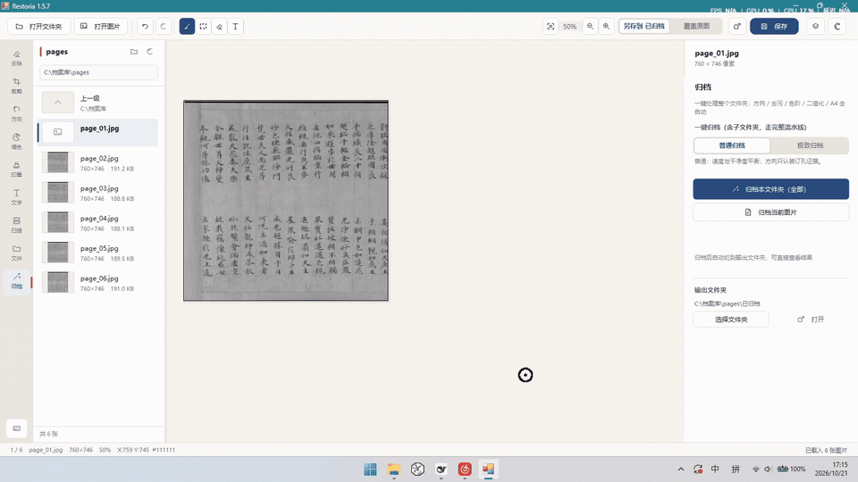
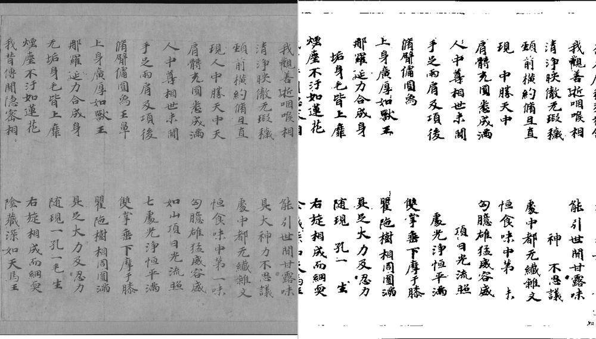
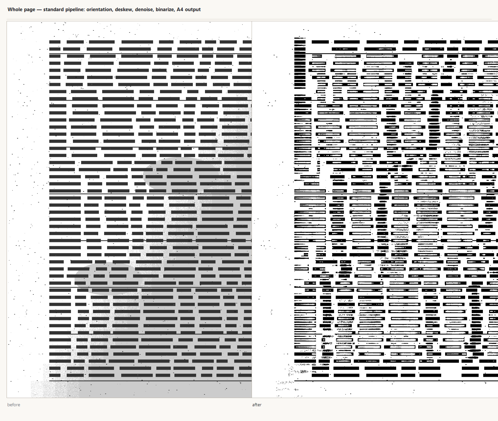
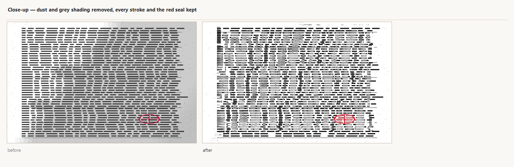
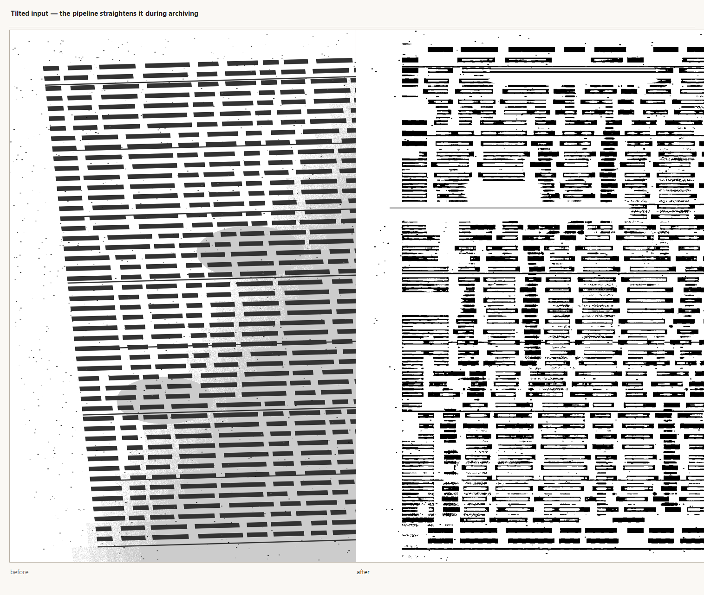

# Restoria

**Turn a folder of flatbed scans from a ring-bound archive into clean, upright A4 pages — offline, on Windows 7 through 11.**

It reads the binding holes to decide orientation, removes dust and uneven lighting, keeps red seals red, and writes an A4 archival copy without touching the originals. One executable, no installer, no network.

**Made for** ring-bound or hole-punched files scanned at roughly 300 DPI on a flatbed.
**Not made for** phone photos (perspective), glue-bound books (no holes to read), or book-cradle scanning with page-curve correction.

Six pages, one click, one A4 folder out — a real screen recording of this build, no mock-up:



> The pages in the clip are crops of the Tang manuscript shown below, scanned in grayscale.
> A higher-quality MP4 is in `docs/images/demo.mp4`.

- **Runs on:** Windows 7 SP1 → Windows 11 (.NET Framework 4.8, AnyCPU)
- **Interface:** hand-drawn with GDI+ and double-buffered, so it stays responsive on old hardware; light and dark themes
- **Code:** ~26,000 lines of C#, zero third-party NuGet packages, builds with the compiler that ships with Windows

---

## Download

Releases are published on the [Releases page](https://github.com/MC5lan/restoria/releases).

| Asset | What it is |
|---|---|
| `Restoria-core.zip` | **~1 MB. No AI, no models.** Extract, run `Restoria.exe`. The fastest way to see whether this is for you. |
| `Restoria-setup.exe` | Full installer, ~45 MB, includes the AI payload. |
| `Restoria-portable.zip` | Same payload, no install: extract, run `setup-boot.exe`. |

The two large bundles include the optional AI assets and the Win7 compatibility layer. The core package deliberately ships neither: the program probes for the AI runtime in a child process, and if it cannot load it disables those features and says so. Everything in the core pipeline works either way.

> **Not signed yet.** Windows will show a publisher warning because the binaries are not code-signed. Choose *More info → Run anyway*.

**From source:** `build.bat` produces `dist\Restoria.exe`. The AI features additionally need the `ai\` folder copied next to it (see [Enabling AI features](#enabling-ai-features)).

---

## Other languages

[中文](docs/README-zh.md) · [日本語](docs/README-ja.md) · [Deutsch](docs/README-de.md) · [Français](docs/README-fr.md) · [Español](docs/README-es.md) · [Русский](docs/README-ru.md)

---

## What it does to a page

A real page, before and after — a Tang-dynasty manuscript leaf, public domain:



> *Mahāratnakūṭa Sūtra*, Tang dynasty, ca. 700. The Metropolitan Museum of Art, public domain (CC0).
> The museum captured it as a colour photograph on a black mount; the sheet was cropped out and
> converted to grayscale — the form a text page arrives in from a flatbed. Command:
> `Restoria.exe --archive page.tif out\ 300`. The full A4 sheet is [here](docs/images/real-a4.png).

The three images below are generated from the deterministic test fixture, so they stay reproducible.
Whole page, standard pipeline — grey paper, uneven lighting and dust go in; white paper and black type come out, laid out on A4:



Close-up of the same page. Dust and grey shading are gone; every stroke of text survives, and the red seal is still red rather than being flattened to black:



A page fed in tilted is straightened as part of the same run:



> These images are generated from a synthetic fixture by `tools\MakeDemo.bat`, not from real archive material — the archive samples this tool is used on are confidential. The fixture is the same deterministic page the test gates use, so the pictures cannot drift from what the code actually does.

---

## What it does

### The one-click pipeline

Orientation → mirror detection → denoise → deskew → black/white level and automatic tone → A4 output.

- **Standard** — balanced speed and cleanliness. Orientation trusts only physical binding-hole evidence.
- **Exhaustive** — removes only the most certain dust specks, and undoes its own work if it starts eating characters. **Would rather leave a speck than lose a single stroke of a handwritten character.** Pages without binding holes fall back to OCR-based orientation. Suits faint handwriting and records where content matters more than speed.

Archiving **only ever creates new files**; the original image is never modified, byte for byte. An interrupted run resumes where it left off. Each batch produces a report listing per-page dimensions, rotation and the reason for it, plus counts and timings.

### Single-page editing

| Tab | What it does |
|---|---|
| Remove | Brush or box select over damage; five fill modes: plain, enhanced, blend, paper reconstruction, AI |
| Crop | Manual crop, or snap to an A4 board |
| Orient | Manual rotation, or one-click deskew (projection-method detection, ±20°) |
| Adjust | Brightness, contrast, saturation, temperature, levels, gamma, unsharp mask (every value is click-to-edit) |
| Seal | Restore faded red seals |
| Batch | Apply fixed parameters across a folder |
| Scan | Talk to a WIA scanner directly; choose the output format (JPG/PNG/TIF) |
| Files | Bulk rename, folder management |
| Text | Stamp annotations onto a page |

### Optional AI inpainting (MI-GAN)

- ONNX Runtime 1.14.1 driving the MI-GAN model; extends long straight structures such as table rules across a damaged area
- **Loaded in a child process, never in the main one.** If the runtime cannot load, the AI features switch off and nothing else is affected
- Win7 support via renamed import-table shims (details in the comments in `src/Ai/AiFill.cs`)

The whole `ai/` payload is 30 files, about 59 MB, and is needed only for AI inpainting and seal OCR.

### Engineering

- **134 headless self-tests** (`--selftest`): algorithm thresholds, undo budget, recovery location, shortcut conflicts
- **Layout baseline regression** (`--layout-check`): compares the current control layout against a checked-in baseline and exits non-zero on any difference, which is what makes it evidence rather than a printout
- **Four gates** (`tools/gate.py`): self-test, layout baseline, AI artifact, performance smoke test
- **Continuous integration**: GitHub Actions builds and runs the gates on every push
- Parallel regression for the archive pipeline: extreme mode at parallel=1/2/4 is byte-identical

---

## Known limitations

Read this before assuming it will handle your material.

- **Orientation needs physical evidence.** The 180° decision relies on binding holes. A page with no binding holes — a glue-bound book, a loose single sheet, a two-hole-punched document — will **not** be rotated automatically. This is deliberate: rotating a table page that was already upright is worse than leaving a flipped page for someone to notice. Use the manual rotate control, or the Exhaustive mode (which falls back to OCR) on pages that genuinely need it.
- **Designed for flatbed-scanner output.** Phone photos have perspective distortion and are not handled.
- **Orientation thresholds assume roughly 300 DPI scans.** At 600 DPI the binding-hole evidence falls outside the calibrated window and the tool falls back to "no rotation".
- **The AI runtime is pinned to ONNX Runtime 1.14.1**, the last version that loads on Windows 7. Before swapping models, check operator compatibility with `python tools\onnx_ops.py --diff ai\migan.onnx candidate.onnx`. (LaMa was dropped because its FFT operator misbehaves in that version's CPU kernels.)
- **Archiving refuses to run over** the Desktop, the root of C:, system folders, or the user profile directory.
- **No code-signing certificate yet,** so Windows shows a publisher warning on first run.

---

## Building from source

**Requirements:** Windows with .NET Framework 4.x. Nothing else — no Visual Studio, no NuGet restore.

```bat
build.bat
```

The output is `dist\Restoria.exe`. The build script:

1. Detects `vendor\onnxruntime_c_api.h`. If present it generates the AI interop layer (`src\Ai\OrtApi.Generated.cs`) and builds with AI support; if absent it builds without it and everything else still works.
2. Embeds the icon (`assets\app.ico`, drawn as GDI+ path geometry by `tools\IconGen.cs` — the source is the single source of truth for the design) and the manifest (`assets\app.manifest`, declaring Win7–11 support and `asInvoker` so it never requests elevation).
3. Writes a `.config` declaring the .NET 4.x runtime.
4. Emits a PDB next to the exe and renames it to match the product name, so a crash report from a field machine can be resolved against matching symbols.

> **About the product name:** `build.bat` compiles to the internal name `dist\PicTool.exe`, then copies it to the published name `dist\Restoria.exe` (from `appname.txt`). The two files are byte-identical. `PicTool` is the internal identifier and the assembly namespace; the name everywhere a user sees is Restoria.

### Building the small core package

`tools\make_core_package.ps1` builds the ~1 MB no-AI bundle (exe + config, nothing else) and can upload it to an existing release:

```powershell
.\tools\make_core_package.ps1                       # build dist\Restoria-core.zip
.\tools\make_core_package.ps1 -Tag 1.5.8 -Upload    # attach it to that release
```

### Enabling AI features

Copy the `ai\` folder next to the exe:

```bat
xcopy /e /y ai dist\ai
```

It contains `onnxruntime.dll`, `migan.onnx`, the `ocr\` models, and the `win7\` shims — 30 files, about 59 MB. If you do not need them, delete `ai\` before building.

### Running the checks

```bat
build.bat                                  :: compile
dist\Restoria.exe --selftest                :: 1. algorithm self-test (exit 0 = pass)
dist\Restoria.exe --layout-check             :: 2. layout vs baseline; exits 1 on any difference
python tools\check_resources.py --strict     :: 3. resource gate (LockBits pairing)
python tools\gate.py                       :: 4. all gates, including the performance smoke test
```

The layout baseline lives in `tools\golden-layout.txt`. After an intentional UI change, regenerate it with `--regen-layout`.

The AI-artifact and performance gates need the fixed test page `_probe\doc_test.png`, which is generated deterministically by `Restoria.exe --make-fixture`. It is checked in, so a fresh clone has it; if it goes missing the gate regenerates it and only fails if generation itself fails.

The performance baseline records a machine tag. A baseline from a different machine is reported rather than silently compared against — run `--regen-perf` to rebuild it locally.

---

## Command-line diagnostics

Headless modes for scripting and bug reports. Reports land in `%TEMP%\PicTool-*.txt`; exit codes are clean and no dialogs appear.

| Flag | Purpose |
|---|---|
| `--selftest` | 134 algorithm and interaction self-tests; exit 0 = all pass |
| `--layout` | Export the control layout snapshot (always exits 0; for inspection only) |
| `--layout-check` | Same snapshot, compared against `tools\golden-layout.txt`; exit 1 on any difference |
| `--archive <in> <out> [dpi] [options]` | Run the pipeline headless |
| `--skew-test <file-or-folder> [n]` | Skew detection with a black-border control comparison |
| `--ai-check` / `--ai-check-silent` | AI runtime and model check (silent for unattended installer use) |
| `--ai-fill <in> <out> [x y w h]` | Inpaint one region to disk, for offline comparison |
| `--paper-fill <in> <out> [x y w h]` | Paper-region reconstruction to disk |
| `--make-fixture [path]` | Export the deterministic test page used by the gates |
| `--bench [golden] [--regen]` | Per-operator timing plus output fingerprints |
| `--wheeltest[=folder]` | Wheel routing across canvas, left rail and right rail |
| `--uityping` | Input-focus decision check, old and new predicates side by side |
| `--undotest` | Undo budget and frame-level rollback check |
| `--cursortest` | Custom cursor shape check, leaves a screenshot |
| `--droptest` | Drag-and-drop receive tree check |

Environment switches: `PICTOOL_AI_TRACE=1`, `PICTOOL_OCR_TRACE=1`, `PICTOOL_SKEW_NOGUARD=1`, and `PICTOOL_RECOVERY_ROOT` (redirects the recovery area; used by the probes so they never touch real user data).

---

## Layout

```
├── src/                  All source (68 .cs files, ~26,000 lines)
│   ├── Program.cs        Entry point, global exception fallback, diagnostic dispatch
│   ├── Core/             Self-test suite, benchmark, version, recovery, bitmap bridge
│   ├── Platform/         System probing, WIA scanning, file utilities
│   ├── Imaging/          Pure image algorithms (no UI dependency): cleaning, enhancement, repair, archiving
│   ├── Ai/               Optional AI layer: ONNX interop, MI-GAN, OCR orientation judge
│   └── Ui/               Interface and interaction (the only place WinForms is referenced)
├── assets/               Icons and manifests. The icon is drawn as GDI+ path geometry
│                         by tools\IconGen.cs, which is the single design source
├── _probe/               Fixed test page used by the gates (regenerate with --make-fixture)
├── tools/                Build and verification toolchain
│   ├── gate.py           The four gates: self-test + layout + AI artifact + performance
│   ├── check_resources.py Resource gate (LockBits pairing)
│   ├── onnx_ops.py       ONNX operator compatibility scan (run before swapping models)
│   ├── archive_demo.py   Before/after comparison image generator
│   ├── make_core_package.ps1  Build/upload the ~1 MB no-AI bundle
│   ├── make_package.ps1  Packaging chain (build → assemble → sign → self-verify)
│   └── install/          Installer and uninstaller source
├── ai/                   Optional AI payload: ONNX runtime + MI-GAN + OCR models + Win7 shims
├── vendor/               onnxruntime_c_api.h (generates the interop layer)
├── docs/                 Translations and architecture notes
├── build.bat             One-command build
├── CHANGELOG.md          Version history
└── THIRD_PARTY_NOTICES   Licenses for every bundled third-party component
```

Dependencies flow one way; reverse references are not allowed:

```
Ui ──→ Imaging / Ai / Platform / Core
Ai ──→ Platform (SysInfo)
Imaging ──→ Platform (a little)
Platform ──→ (nothing)
```

`Imaging` and `Ai` must not reference `System.Windows.Forms`. Algorithms take parameters and return new bitmaps; they do not mutate global state.

---

## Third-party components and licenses

Restoria's own code is MIT licensed (see [LICENSE](LICENSE)). The components below ship inside the release bundle and remain under their own licenses:

| Component | Version | Copyright | License |
|---|---|---|---|
| ONNX Runtime (`ai\onnxruntime.dll`, `ai\win7\onnxruntime.dll`) | 1.14.1 | © Microsoft Corporation | MIT |
| PP-OCRv3 detection/recognition models + dictionary (`ai\ocr\`) | PP-OCRv3 | © PaddlePaddle Authors | Apache-2.0 |
| MI-GAN inpainting model (`ai\migan.onnx`) | 512, ICCV 2023 | © 2024 Picsart AI Research | MIT |
| Win7 API-set compatibility shims (`ai\win7\w7shim-*.dll`) | built for this project | — | MIT |
| Win7 API-set fallback copies (`ai\win7\api-ms-win-core-*.dll`) | Windows 7 SP1 | © Microsoft Corporation | see THIRD_PARTY_NOTICES |

Full license texts and details are in **[THIRD_PARTY_NOTICES](THIRD_PARTY_NOTICES)**.

These components serve **only** the optional AI inpainting and seal OCR. The core pipeline — orientation, deskew, denoise, stain removal, black/white level, tone, A4 output — is pure C# with no native dependency and runs fully without the `ai/` directory. The program probes whether the AI runtime can load, in a child process, and disables those features cleanly if it cannot; no AI code path ever runs inside the main process.

## Acknowledgements

- [ONNX Runtime](https://github.com/microsoft/onnxruntime) — cross-platform inference engine
- [MI-GAN](https://github.com/Picsart-AI-Research/MI-GAN) — image inpainting model, ICCV 2023
- [PaddleOCR](https://github.com/PaddlePaddle/PaddleOCR) — PP-OCRv3 detection and recognition models
